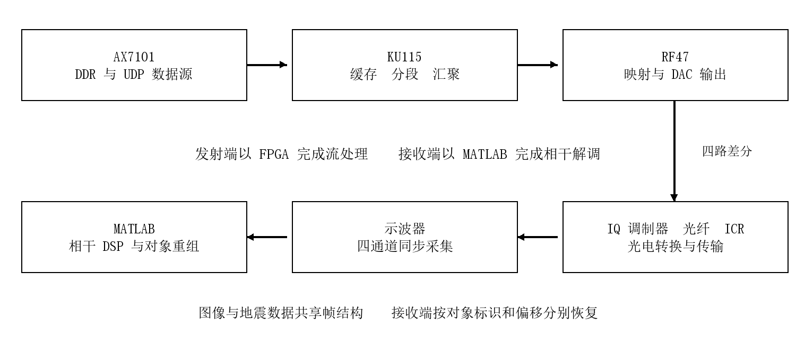
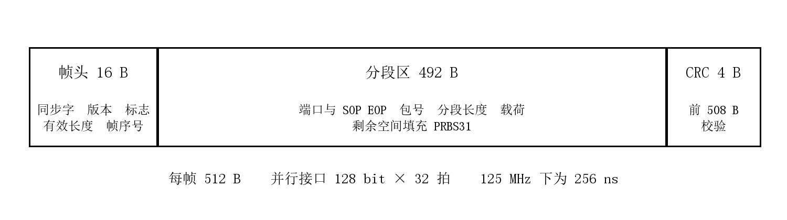
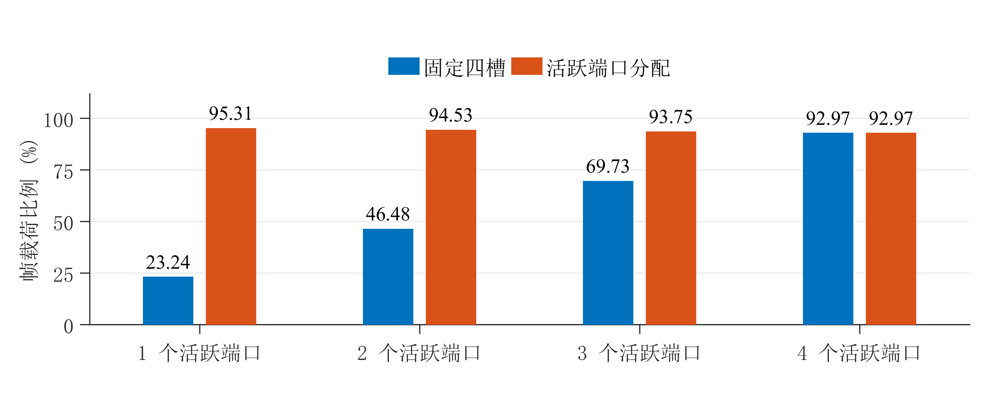
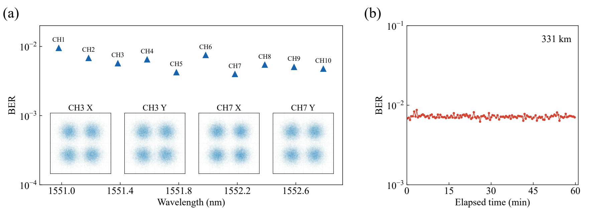
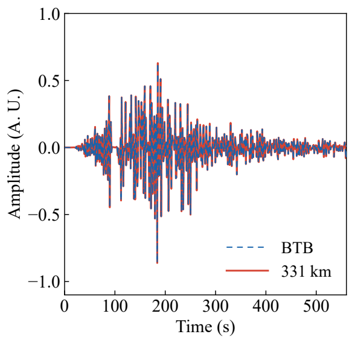

2026 年全国大学生嵌入式芯片与系统设计竞赛

FPGA 自主赛道初级组

面向水下图像与地震波的
FPGA 多源汇聚及相干光传输系统

设计报告

作者  刘子轩  沈晖  吴凡

2026 年 10 月

FPGA 嵌入式赛道参赛版

## 摘要

水下图像与地震波形的数据长度、到达节奏和重组方式不同。为使两类信息共用高速传输链路，我们搭建了由 AX7101 数据源、KU115 多端口汇聚、RF47 波形发射和 MATLAB 相干接收组成的实验系统。发送端使用独立端口缓存保存数据，以描述符管理包边界，将长包拆入 512 B 汇聚帧；接收端按端口、包号、对象标识和偏移恢复图像及地震采样。

系统采用 4 Gbaud DP-QPSK 调制，单波长毛比特率为 16 Gb/s，10 个 WDM 波长合计 160 Gb/s。汇聚层按活跃端口数分配分段额度，单端口满分段时帧载荷比例为 95.31%。当前源码通过三个 RTL 用例及 MATLAB 协议测试。项目的 331 km G.654.E 无中继实验中，十个信道的最佳 BER 均低于 10⁻²；CH3 约一小时、130 个有效窗口的加权 BER 为 7.193×10⁻³，低于 2×10⁻² 的 SD-FEC 参考门限。接收端通过累积 CRC 正确片段，完整恢复三幅水下图像和 11200 点地震波。[5]

本设计将多源信息汇聚和可验证的信息恢复放在同一条链路中实现。除源码与构建入口外，项目还提供流完整性、BER 统计和示波器读取三个可复用 skill，便于在相同条件下重跑测试和定位故障。

关键词  FPGA  多源汇聚  DP-QPSK  分段传输  水下监测

### 内容索引

1  任务需求与设计选择	3

2  系统结构与数据通路	4

3  三板卡 FPGA 功能与实现	5

4  多源信息汇聚与帧协议	9

5  相干接收与信息重组	11

6  传输效率与性能边界	12

7  功能验证与接收结果	13

8  工程复现与操作流程	17

9  AI 协作与可复用 skill	18

10  创新归纳与总结	19

附录  提交材料与演示核查	20

## 1 任务需求与设计选择

### 应用对象与主要矛盾

图像需要恢复每个像素的位置和颜色；地震波需要保持采样顺序、数值及时间尺度。两类信息可以都表示为字节，却不能仅按接收顺序拼接。共享链路必须保留业务归属与偏移，同时处理不同包长和不同端口到达速度。我们因此把“统一传输”和“分别恢复”作为设计起点。

单纯给每个端口分配固定时隙容易在端口空闲时浪费帧空间。直接合并字节流又会丢失原始包边界。设计采用端口缓存、包描述符和帧内分段，使发送端能够依据有无有效数据规划帧，接收端能够还原原始对象。

| 项目 | 规格或要求 |
|---|---|
| 图像 | 3 幅 160×120 RGB888，每幅 57600 B |
| 地震波 | 11200 点，大端 int16，20 Hz，共 22400 B |
| 汇聚入口 | 四端口以太网，按端口分别保存数据和包描述 |
| 发射信号 | 4 Gbaud DP-QPSK，8 GSPS DAC |
| 接收方式 | 四通道同步波形采集，MATLAB 相干 DSP |
| 恢复原则 | 仅采用校验通过的接收片段；缺失位置保留覆盖标记 |

### 方案选择

采用多 FPGA 分工，既复用现有以太网、QSFP 和射频采样接口，也能分别验证数据源、汇聚器及发射器。KU115 在固定时钟下完成数据规划与帧输出；RF47 负责连续波形；复杂的接收参数观察与调整放在 MATLAB。这样可以单独检查包计数、帧边界和接收比特，不必把所有异常都归因于光路。

评价采用三组指标：物理层错误位及比较位数；聚合帧 CRC 与包重组状态；应用对象覆盖率及完整对象校验。它们分别回答信号是否解对、片段是否可信、信息是否收全。

## 2 系统结构与数据通路

图 1 系统功能划分与信号流向

AX7101 从 DDR 读取图像和地震数据，按应用格式封装后经 UDP 发送。KU115 对各入口分别缓存，在公共输出侧组成固定长度汇聚帧，通过 QSFP 送入 RF47。RF47 将帧比特映射到 XI、XQ、YI、YQ 四个实数分量，再由 DAC 输出到 IQ 调制器。光接收端的 ICR 输出四路电信号，经示波器同步采集后进入 MATLAB。

| 层级 | 负责的处理 | 主要检查点 |
|---|---|---|
| 数据源 | 对象存储与 UDP 发送 | 数据长度、地址、发送计数 |
| KU115 | 跨时钟缓存、描述符、分段与 CRC | 读写接受条件、帧格式、溢出标志 |
| RF47 | QSFP 接收、模式选择、映射与 DAC | 接收状态、输出模式、差分对应关系 |
| 接收端 | 符号恢复、包重组、对象显示 | BER、CRC、覆盖率与对象校验 |

### 速率关系与连接约定

4 Gbaud DP-QPSK 每个符号携带两偏振共 4 bit，对应 16 Gb/s 毛比特率。128 bit、125 MHz 帧接口与这一速率相配；8 GSPS DAC 提供每符号两个采样点。四个 1 GbE 入口的业务供给与高速帧线速分别核算，入口未提供有效载荷时由填充序列维持连续输出。

RF47 正端为 TX0、TX2、TX4、TX6，负端为 TX1、TX3、TX5、TX7。光接收时示波器 CH1 至 CH4 连接 ICR 的 XI、XQ、YI、YQ；电对齐时连接对应 TX 输出。两种接线用途不同，软件入口分别处理。

## 3 三板卡 FPGA 功能与实现

### 3.1 职责划分与接口组织

系统将数据组织、网络汇聚和高速波形生成分别放在 AX7101、KU115 与 RF47 上。三块板通过明确的报文与码流接口协作：AX7101 提供可重复的业务输入，KU115 保留来源与包边界并组成连续汇聚帧，RF47 将码流转换为四路 I/Q 分量及八路 DAC 输出。

| 板卡及器件 | 输入与输出 | 核心职责 |
|---|---|---|
| AX7101
Artix-7 XC7A100T | DDR3 数据集、摄像头接口
千兆以太网 UDP 输出 | 数据读取、对象分段、UDP 封装与端口测试 |
| KU115
Kintex UltraScale XCKU115 | 四路以太网输入
QSFP Aurora 码流输出 | 协议校验、独立缓存、活动端口调度、固定帧汇聚 |
| RF47
Zynq UltraScale+ RFSoC XCZU47DR | QSFP 码流或本地测试源
八路 DAC 电信号输出 | 帧对齐、DP-QPSK 映射、延迟校准与运行控制 |

### 时钟与吞吐量的对应关系

高速线速率通过并行处理获得。KU115 的汇聚接口每周期输出 128 bit，在 125 MHz 下对应 16 Gb/s；RF47 的映射接口每周期接收 64 bit，在 250 MHz 下同样对应 16 Gb/s。每 4 bit 构成一个 DP-QPSK 符号，因此 RF47 每周期处理 16 个符号，得到 4 Gbaud 符号率。

| 处理位置 | 并行组织 | 时钟或等效速率 |
|---|---|---|
| AX7101 数据发送 | DDR 读侧与 8 bit GMII 发送侧异步衔接 | GMII 125 MHz；每端口 1 Gb/s |
| KU115 汇聚输出 | 128 bit 定宽码流；桥接为 256 bit AXI-Stream | 汇聚域 125 MHz；16 Gb/s |
| RF47 符号与采样 | 每分量 16 符号、每符号 2 点 | 250 MHz；4 Gbaud、8 GSa/s |
| RF47 DAC 接口 | 每通道每周期 16 个 16 bit 采样值 | 500 MHz AXI；等效 8 GSa/s |

### 板间接口的完整性检查

板级联调同时检查三类状态。数据源检查 DDR 就绪、读错误和 UDP 发送计数；汇聚板检查各端口接收计数、校验错误及缓存溢出；波形板检查 Aurora 链路、帧锁定和 DAC 数据通路状态。发生异常时可沿同一条数据流定位到具体板卡，再与接收端 CRC 和 BER 结果对照。

以太网入口的业务速率、单波光载波的 16 Gb/s 毛线速率以及十波合计 160 Gb/s 分别描述不同层次。空闲帧维持连续发送，不能计为图像或地震波的净业务吞吐量。

### 3.2 AX7101 数据源与 UDP 发送

AX7101 负责把应用对象变为带标识的数据包。顶层控制逻辑将 DDR3 读通路、图像和地震数据游标、以太网发送器及调试计数器连接起来。固定数据集由 JTAG 装入 DDR3，板卡随后自主循环读取，保证相同内容能够用于电直连、光背靠背和长距离传输对照。

#### DDR3 读取与发送解耦

存储读取逻辑先等待 DDR 校准完成，再读取数据描述区的版本、就绪标志和对象 CRC。进入发送状态后，读调度器在图像与地震两路请求间轮转。当前实例采用 64 bit AXI 读接口、最长 32 拍突发，并根据对象剩余长度及 4 KiB 边界缩短突发。

两路数据各经过一个 32 KiB 异步 FIFO，从 DDR 用户时钟域进入 125 MHz 发送域。发起突发前检查 FIFO 余量；地址被接受后收完整个突发，避免途中停顿占住共享读通道。FIFO 还将 64 bit 数据转换为按序输出的字节流，使存储访问节奏不必与以太网逐字节发送同步。

| 端口 | 功能 | 本工程中的组织方式 |
|---|---|---|
| 网口 1 | 水下图像 | 三个对象循环发送；每幅 160×120×3 = 57600 B |
| 网口 2 | 地震波形 | 22400 B，即 11200 个 int16 采样值 |
| 网口 3 | 双摄像头扩展 | 可发送摄像头数据并保留 VGA 显示通路 |
| 网口 4 | 接收检查或 PRBS31 测试 | 默认接收检查；运行时可切换 PRBS31 发送 |

#### 对象分段与报文生成

对象分段控制逻辑维护对象号、循环号、包序号及对象内偏移。每包最多承载 1368 B 有效数据，末包用有效长度和结束标志限定范围。UDP 封装单元加入 32 B 应用头形成 1400 B UDP 载荷，携带数据类型、源端口、对象总长和对象 CRC。接收端据此区分图像与地震波，并把片段放回各自对象的位置。

发送器设置两个报文缓存槽，允许下一包填充与当前包发送交叠，并生成 IPv4、UDP 校验和及以太网 FCS。输入有效长度超出上限或末字节标志与预期不一致时，累加输入错误计数。网口 4 的模式控制等待当前以太网帧结束后再切换发送源，避免在一帧中途改变 GMII 输出。

#### 板上可观测状态

ILA 与 VIO 暴露 DDR 校准、描述区读取、存储响应错误、FIFO 上下溢和各端口发送计数。发送计数增长证明数据通路在工作，错误计数及接收对象校验则用于判断内容是否保持完整。

### 3.3 KU115 多端口缓存与分段汇聚

KU115 是多源信息的汇聚节点。四个以太网入口各自完成接收和校验，再把有效 UDP 载荷与包描述符送入汇聚域。它不依赖图像的像素结构或地震采样值，而是保留端口、包号、长度及分段边界，因此可处理不同内容、不同长度和不同到达节奏的业务。

#### 独立缓存与跨时钟域

每个入口采用双缓存保存接收中的报文，校验通过并提交后再交给汇聚侧。四个端口分别设置字节 FIFO 和 24 bit 描述符 FIFO：描述符由 8 bit 包号与 16 bit 长度组成，载荷无需为每个字节重复存储这些字段。

四路字节流经异步 FIFO 进入 125 MHz 汇聚域；每路载荷 FIFO 深度为 32768 字节，并通过 ready 信号控制缓存向汇聚侧的交付。目的时钟域设置预取缓存，把异步 FIFO 的读取延迟转换为稳定的 valid/pop 接口。载荷与描述符分别保留溢出标志，防止仅观察总字节数而遗漏包边界异常。

#### 活动端口调度与连续帧输出

汇聚调度器以“已有未完成包上下文或存在新描述符”确定候选端口。每帧根据候选数计算分段额度，并从轮转指针开始排列记录。长包未发送完时保存剩余长度和包号，下一帧继续发送；分段头携带端口号、包号、长度以及 SOP/EOP 标志，具体帧结构见第四章。

汇聚器用两组帧缓存交替完成构建与发送。每个 512 B 帧包含同步头、序号、分段记录和 CRC32；没有业务载荷时输出空闲帧，剩余空间由确定规则的 PRBS31 填充。128 bit 输出在 125 MHz 下形成连续 16 Gb/s 码流，业务突发由入口缓存吸收。

#### QSFP 位宽桥接与反压保持

QSFP 桥接单元将相邻两个 128 bit 字组合成 256 bit AXI-Stream 数据，并把帧尾标志随数据一起跨时钟保存。输出端设置当前字与预取字两级缓存，只有 tvalid 与 tready 同时成立时才推进发送；等待期间保持数据和 tlast，避免重复读取或覆盖尚未被接收的字。

异步缓存吸收短时速率差。链路未就绪时停止桥接并等待帧首；缓存溢出时设置粘滞错误，同样重新建立帧边界。它为可观测的异常恢复提供依据，不能将有限缓存解释为能够承受无限时长的输出阻塞。

| 硬件功能 | 实现重点 |
|---|---|
| 接收报文缓存 | 整包缓存、提交和释放，维护接收包边界 |
| 四端口异步缓存 | 四端口独立缓存、跨时钟与端口计数 |
| 帧规划与构建 | 活动上下文、分段规划、帧缓存和 CRC32 |
| QSFP 位宽桥接 | 128→256 bit 桥接、预取和 AXI 握手保持 |

### 3.4 RF47 符号映射与八路 DAC 输出

RF47 采用 XCZU47DR，将网络传来的汇聚码流转换为可驱动 IQ 调制器的电信号。PL 实现持续码流与采样处理；PS 侧程序负责时钟及 RFDC 初始化、DAC 多 Tile 同步和运行模式设置。参数修改通过寄存器及跨时钟同步送入数据通路。

#### 接收对齐与速率匹配

接收对齐逻辑在 Aurora 输出中寻找同步头并恢复固定帧边界，同时记录头部与字节有效标志异常。随后，异步缓存把 256 bit 接收字转换为 250 MHz 域的 64 bit 数据，缓冲板间时钟差及突发。FIFO 接近高水位时，空闲帧匹配器只在空闲帧首作出丢弃决定，并移除完整空闲帧，以免截断业务帧。

#### DP-QPSK 映射与并行采样

符号映射单元每周期读取 64 bit，按 XI、XQ、YI、YQ 的顺序将每组 4 bit 分给四个分量，一次形成 16 个双偏振符号。当前通路采用矩形 NRZ、每符号 2 个采样点，每分量在 250 MHz 周期内生成 32 点，再由 512→256 bit gearbox 转入 500 MHz DAC 接口。

| 电分量 | DAC 正端与负端 | 连接功能 |
|---|---|---|
| XI | TX0 / TX1 | X 偏振同相分量 |
| XQ | TX2 / TX3 | X 偏振正交分量 |
| YI | TX4 / TX5 | Y 偏振同相分量 |
| YQ | TX6 / TX7 | Y 偏振正交分量 |

每个差分对共享可配置的七抽头发端预均衡结果，再生成相反极性，并独立补偿两端时延。运行时延迟控制同时提供整点与 1/32 采样间隔的细调。八路通道的有效标志与 DAC 就绪状态共同约束数据推进，配合多 Tile 同步减少通道间相位和字序不一致。

#### 三种运行模式与验证流程

方波模式用于八通道延迟对齐。RF47 输出周期性方波，根据示波器测得的边沿时差调节各通道延迟，校正四组差分端及各 I/Q 通道的相对时序，为后续调制建立一致的时间基准。

长 PRBS 循环模式用于物理层连接与 BER 测试。RF47 循环发送四路已知 PRBS 序列，接收端完成相干解调后，与匹配的参考逐比特比较，并显示星座图、EVM 和 BER，用于核验电连接、光调制及传输链路的质量。

信息模式用于传输真实业务。RF47 经 QSFP 接收 KU115 汇聚的水下图像和地震波数据，沿同一符号映射与 DAC 通路输出；接收端通过帧头、对象标识与 CRC 校验重组载荷，恢复三幅图像和地震波形。

联调按“方波对齐—长 PRBS 验证—信息传输”推进，依次检查通道时序、物理层误码和真实信息恢复。

## 4 多源信息汇聚与帧协议

### 活动上下文与分段额度

每个入口的数据字节与包描述符分别保存。描述符给出包长度等边界信息；活动上下文保留尚未发送完的包号、剩余长度和分段状态。候选端口由“已有未完成上下文”或“出现有效描述符”确定，避免仅凭瞬时 valid 判断整包是否可发送。

512 B 汇聚帧去掉 16 B 帧头和 4 B CRC 后，可用于分段的区域为 492 B。每个活跃端口预留一个 4 B 分段头，剩余空间按活跃数分配。实际片段长度取该端口额度和包剩余长度中的较小值。

| 活跃端口数 | 每端口额度 | 总载荷上限 | 含分段头占用 |
|---|---|---|---|
| 1 | 488 B | 488 B | 492 B |
| 2 | 242 B | 484 B | 492 B |
| 3 | 160 B | 480 B | 492 B |
| 4 | 119 B | 476 B | 492 B |

规划的起始端口逐帧轮换，端口上下文跨帧保留。这样既能容纳远大于单帧容量的包，也不需要接收端按固定时隙猜测业务。若某端口为短包，其未使用额度不保证在同一帧内重新分给其他端口；剩余区域进入填充处理。

### 缓存与跨时钟处理

入口与输出时钟不同，缓存需要同时满足数据完整性和时钟域隔离。写入计数以接口实际接受的数据为准，输出侧只有读出有效数据才推进对应状态；AXI 流接口按 valid 与 ready 同时成立进行计数。包描述符的消费与数据消费必须一致，否则会出现“长度正确、内容错位”的隐蔽错误。

对无法接受的输入，设计通过溢出状态向上层暴露异常。验证时不以增大 FIFO 掩盖错误，而是检查溢出条件、错误标志以及后续输出边界。持续数据流用例同时检验内容顺序、tkeep 和 tlast，以防止只看总字数而遗漏重复或错序。

图 2 固定长度汇聚帧结构

| 偏移 | 长度 | 字段含义 |
|---|---|---|
| 0 至 7 | 8 B | 同步字 D5 C0 1A CF FC 1D 5A A5 |
| 8 至 9 | 2 B | 版本与帧标志 |
| 10 至 11 | 2 B | 有效分段区域长度 |
| 12 至 15 | 4 B | 汇聚帧序号 |
| 16 至 507 | 492 B | 分段记录及填充 |
| 508 至 511 | 4 B | 前 508 B 的 CRC32 |

分段记录由 tag、packet_id、16 bit fragment_length 和载荷组成。tag 保存端口与 SOP/EOP；包号使接收端能够判断片段是否属于正在组装的同一个包。CRC32 采用 0x04C11DB7 多项式、全 1 初值和最终取反；两端字节顺序与位运算约定一致。

### 业务区分与对象寻址

汇聚层回答片段属于哪个端口、哪个包；应用层 AXDS 头进一步给出对象类型、对象标识、包序号、对象偏移、总长度和对象 CRC。接收端先重组包，再把包中的载荷写入对应对象的偏移位置。图像与地震即使在同一链路上交错出现，也能按字段确定归属。

重复片段覆盖同一位置，不增加对象长度；未收到的位置保持缺失标记。对象收全后再检查完整对象 CRC。填充区使用与帧序号关联的 PRBS31，因此信息模式的空闲内容有明确生成规则，不能把它当作全零或任意一段回放参考。

## 5 相干接收与信息重组

### 从波形到符号

示波器每次冻结同一组采样记录，再读取 XI、XQ、YI、YQ。接收程序根据回读 preamble 解释采样间隔、幅度换算和点数，先消除直流并进行幅度预处理，再按具体链路完成定时、频偏、均衡和载波相位恢复。需要长距离传输时加入色散补偿。

CMA 通过模值误差调整均衡器，适合在没有完整载荷参考时进行初始恢复；LMS 利用已知符号误差更新抽头，可用于参考已匹配的训练区间。具体更新方式、步长和训练长度由相应 DSP 入口控制。最终判决按偏振和 I/Q 分量映射成四路比特，随后进入帧同步与解析。

### 同步与统计口径

PRBS 回放与信息传输使用同一硬件链路，但数据统计特性和参考来源不同。对物理层 BER，首先核对发送模式、参考标识以及映射和延迟，再在留出的测试位上统计整数错误数。用于调参或均衡训练的数据不计入最终测试分母。

总 BER = 各窗口错误位之和 ÷ 各窗口比较位之和。若每窗比特数不同，直接平均窗口 BER 会改变权重。失去同步的窗口保留时间和无效状态，不记为零；0/N 表示在 N 位中未观察到错误。重复码型上的低误码还需要通过实际信息传输检查其适用性。

| 指标 | 计算或判据 | 回答的问题 |
|---|---|---|
| 物理层 BER | 判决错误位数 / 比较位数 | 符号恢复是否正确 |
| CRC 好帧率 | CRC 正确帧 / 检测并检查的帧 | 候选传输帧是否可信 |
| 对象覆盖率 | 有效接收字节 / 对象总字节 | 图像或波形是否收全 |
| 完整对象校验 | 收全后计算对象 CRC | 对象内容是否完整一致 |

### 信息恢复与显示

解析器只把通过校验的片段交给对象缓存。显示层按三幅水下图像在上、地震波形在下的布局刷新；多次采集按对象偏移累积覆盖。载荷参考用于校验与对比，缺口保持可见。接收波形的幅值按 int16 解释，时间轴按 20 Hz 采样率生成。

## 6 传输效率与性能边界

图 3 满分段条件下的帧载荷比例计算对比

以每个端口固定保留 119 B 载荷的四槽方案作计算基线。N 个端口活跃时，其有效帧载荷为 119N B；本设计在长包可填满分段的条件下，分别可承载 488、484、480 和 476 B。图 3 是由帧格式计算的上限，不是吞吐量实测。

| 活跃数 | 固定四槽 | 活跃端口分配 | 可用载荷倍数 |
|---|---|---|---|
| 1 | 23.24% | 95.31% | 4.10 |
| 2 | 46.48% | 94.53% | 2.03 |
| 3 | 69.73% | 93.75% | 1.34 |
| 4 | 92.97% | 92.97% | 1.00 |

例如单端口传输 700 B 包，在每帧只给 119 B 的基线中至少需要 6 帧；按 488 B 分配至少需要 2 帧。该计算说明片段规划对长包跨帧次数的影响。实际进入队列的时间、其他端口参与情况及规划流水线会影响最终等待时间。

每个 512 B 帧对应 32 个 128 bit 字，125 MHz 下占 256 ns。四个 1 GbE 入口的业务供给低于 16 Gb/s 输出毛速率，所以帧空间利用率提高不等于应用吞吐量按相同比例增加。吞吐量仍须扣除以太网、UDP、应用头部及空闲占用；331 km 实验中的 10 波合计 160 Gb/s 同样为毛线速率，不等同于应用净吞吐量。

## 7 功能验证与接收结果

### RTL 功能测试

针对本次提交源码，在独立 Vivado 2021.2 仿真工程中运行三个用例。工程由脚本按相对路径加入源文件，不依赖原板卡工程缓存。测试检查实际输出字段和数据内容，并在断言失败时返回失败结果。[1]

| 用例 | 激励与检查 | 结果 |
|---|---|---|
| 动态分段 | 4 端口分别给出 130、3、700、2 B 包；检查初始空闲帧、三个数据帧的字段、载荷和 PRBS 填充 | 通过 |
| 溢出上报 | 使异步字节桥达到写入溢出条件，检查 sticky 状态 | 通过 |
| 持续流与背压 | 输入 50 帧共 1600 个 128 bit 字；输出应为 800 个 256 bit 拍，逐拍检查数据、keep 和 last | 通过 |

### 持续流测试的意义

持续流用例的源时钟周期为 8 ns，即 125 MHz。输出时钟周期约 6.206 ns，ready 在每 16 拍中保持 12 拍有效、4 拍无效。接收端只在 valid 与 ready 同时成立时计数，期望总计 800 拍，并核对每个 256 bit 字中前后两个 128 bit 字的顺序。测试结束时，溢出及源帧错误标志均未置位。

该用例覆盖了持续供数与周期性背压的组合，验证了缓存和位宽转换在这一条件下不重复、不漏读。它没有穷举任意长度的背压，也不替代硬件时序分析。使用更慢下游或更长突发时，仍需根据接受率和最长阻塞时间核算缓存。

### 包边界检查

动态分段用例同时包含极短包和跨帧长包。700 B 包分多帧传输，接收检查既比较数据字节，也比较包号、长度及起止标志。这样可以区分“总字节数碰巧正确”和“原包确实被还原”，为上层对象重组提供可靠输入。

### MATLAB 协议与错误注入测试

MATLAB R2016a 通过离线自检，使用本地参考数据与构造波形验证重采样、符号判决、帧检查和重新同步。测试不连接示波器或 JTAG，数值属于软件合成用例。[2]

| 测试 | 观测结果 | 验证内容 |
|---|---|---|
| 连续重采样等价性 | 49156 个恢复符号，判决差异为 0 | 分块/连续处理的一致性 |
| 波形到帧恢复 | 47 个 CRC 好帧 | 四路判决、字节打包与帧解析 |
| 精确错误注入 | 检测出 3 bit 错误；第 3 帧 2 bit，第 9 帧 1 bit | 错误位置与统计分母 |
| 滑移后重新同步 | 插入 32 B 偏移后恢复 20/20 CRC 好帧 | 重新搜索帧边界的能力 |

### 数据一致性检查

正式数据集两端使用相同清单，图像为 RGB888 行优先存储，波形为大端 int16。离线校验逐项检查 MEM 与 BIN 表示、文件长度、CRC32 和 SHA256；AX7101 与 MATLAB 参考副本逐字节一致。DDR 加载工具另生成包含写入和读回操作的离线计划，用于检查目标区域与数据长度。[3]

### 辅助工具测试

对齐测量的 C# 核心通过分片 TCP 数据读取、畸形二进制块拒绝、100/125/180 MHz 方波以及分数采样延迟等离线测试。BER 审计工具通过加权分母与无效窗保留检查，并拒绝十类构造错误，包括训练测试重叠、重复统计、错误数越界和无效窗伪装为零误码。两个测试只说明各自输入条件下的行为，不替代现场标定或链路测量。

## 7 功能验证与接收结果 331 km BER

长距离验证采用项目组的 331 km 无中继传输实验记录。 链路为 331 km G.654.E 光纤，放大级位于终端，跨段内无电供电中继器。飞行时间法测得约 1.621 ms 的附加传播时延，与约 331 km 距离相符。系统以 4 Gbaud DP-QPSK 传输，10 个 WDM 波长合计毛线速率 160 Gb/s。

图 4 331 km 后十信道 BER、典型星座与 CH3 一小时 BER

图 4 中 CH1 至 CH10 为 WDM 波长通道。左图给出各通道的最佳 BER 及 CH3、CH7 的 X/Y 星座，右图给出 CH3 的长时记录；最佳值比较与长时稳定性采用不同统计口径。

| 指标 | 实验结果 |
|---|---|
| 十个 WDM 信道 | 各信道最佳 BER 均低于 10⁻²；CH7 最低、CH1 最高 |
| 长时记录通道 | CH3，1551.583 nm，约一小时 |
| 有效统计窗口 | 130 个；所记录窗口 BER 均低于 10⁻² |
| 错误比特与加权 BER | 65452 个错误比特；加权 BER 为 7.193×10⁻³ |
| SD-FEC 参考门限 | 20% 开销，2×10⁻²；采用文献[5]的比较基准 |

### FEC 门限对照

按 2×10⁻² 的 SD-FEC 参考门限衡量，十信道最佳 BER 以及 CH3 长时记录均位于门限以下。该结论是对译码前 BER 的比较；本报告不将门限对照写成已验证的 FEC 译码后零误码。长时 BER 按采集窗口统计，不代表整小时内对所有发送比特连续检测。

## 7 功能验证与接收结果 331 km 信息恢复

下列图片为 331 km 传输后的接收结果；地震曲线同时给出参考与接收记录，BTB 虚线仅作为参考，红色实线对应 331 km 后的接收记录。

    

图 5 331 km 无中继传输后恢复的三幅水下图像

图 6 331 km 接收地震波与参考记录对比

| 核验对象 | 实验结果 |
|---|---|
| 水下图像 | 3 幅 160×120 图像；恢复 JPEG 文件逐字节一致，解码像素差为 0 |
| 地震记录 | 11200 个 16 bit 有符号采样值，采样间隔 0.05 s |
| 时间范围 | 采样率 20 Hz；末时间戳 559.95 s |
| 重构一致性 | 地震采样在每个时间点与参考一致，重构均方根误差为 0 |

上述一致性结果来自对完整对象的校验。接收端通过重复传输累积 CRC 正确片段，最终拼接完整图像和地震记录；完整对象恢复与图 4 的非零物理层 BER 可以同时成立。它验证了 331 km 后应用信息能够恢复，不意味着每次传输的每个片段均无错误。

## 8 工程复现与操作流程

### 环境与构建入口

工程使用 Windows、Vivado/Vitis 2021.2、MATLAB R2016a、Python 3.10 及以上和 .NET Framework 4.x。板卡和商业工具许可由运行环境提供。代码按 AX7101、KU115、RF47 和 MATLAB 分目录组织，外部程序通过 PATH、SMF 环境变量或本地配置定位，资源文件以仓库路径为基准。

| 步骤 | 执行内容 |
|---|---|
| 离线校验 | 核对数据、固件和必需依赖的一致性 |
| 软件准备 | 准备启动与控制工具，核验连接参数 |
| RTL 验证 | 运行分段、跨时钟缓存和持续流自检 |
| 接收算法自测 | 核验重采样、同步、帧解析及错误注入 |
| FPGA 构建 | 分别生成三块板卡的配置文件及 RF47 初始化程序 |
| 接收界面 | 启动 GUI，确认工作模式后再启用采集 |

### 板上演示顺序

先检查数据集和固件标识，再加载 AX7101 配套数据并核对读回结果；随后检查 KU115 汇聚与 QSFP 状态，以及 RF47 接收和输出模式。物理层演示使用对应 PRBS 参考，观察双偏振星座与 BER 时间曲线。信息演示切回信息模式，以接收好帧累积三幅图像和地震对象覆盖，最后导出结果进行比较。

示波器一次只由一个程序控制。采集后先核对实际采样率、点数、四路长度和量程，再运行 DSP；不支持的存储深度回退、二进制读取未完成或参考不同步，都应在进入错误统计前被识别。

### 源码与版本管理

公开版本保留已选定的接收算法，路径和入口调整通过基准及发布哈希记录。固件清单管理配套 BIT、ELF、LTX 等文件。工程缓存、旧测试中间文件和本机配置不纳入默认发布内容。原创源码、文档及 skill 使用 MIT，第三方 IP 与数据保留各自条款。

## 9 AI 协作与可复用 skill

### 分工与验证方式

AI 参与了依赖梳理、启动器补全、协议说明和测试脚本整理。团队确定板卡连接、实验条件与发布范围，编译器和测试断言负责检验生成结果。对于涉及采集或烧录的操作，先明确当前模式和设备占用；对于代码修改，先保留版本，再用相同用例复验。

一次具体修正发生在 C# 方波测量中：初稿在 lambda 中使用 out 参数，.NET 编译器给出 CS1628。改用局部变量后重新编译，再检查三个频点及已知延迟。另一处故障测试最初只捕获 IOException，未覆盖实际的 InvalidDataException；补齐对应异常后，畸形数据拒绝测试通过。记录保留了失败原因、修正位置和复验入口，而不是只保留最后一句“通过”。[4]

| Skill | 固化的方法 | 可运行检查 |
|---|---|---|
| 流完整性 | 按有效握手比较内容、计数和包边界；将 FIFO 溢出纳入断言 | 三个 RTL 用例 |
| BER 核查 | 匹配参考、分离训练测试、加权分母、保留无效窗 | 十类故障输入拒绝 |
| 采集诊断 | 按二进制块长度读满数据；核对点数、极性、频率与延迟边界 | SCPI 与合成方波自测 |

### 复用条件

每个 skill 配有独立使用说明，说明触发条件、执行顺序、源码入口和失效边界。流完整性 skill 可迁移到其他 FIFO/AXI 工程，但需重新确认读延迟与复位规则；BER skill 适用于提供明确计数和参考来源的实验；采集 skill 的二进制检查可复用，仪器命令与标定参数仍须按型号核实。

本项目用三类具体测试验证 skill 的执行效果，不以提示词长度或对话次数评价贡献。它们帮助下一次调试从可重复的步骤开始，并保留足够的信息判断一次低误码结果究竟对应哪些位、哪种模式和哪些有效窗口。

## 10 创新归纳与总结

### 异构信息的可追踪分段汇聚

第一项设计贡献是把端口缓存、包描述符、跨帧上下文和对象寻址连成完整通路。发送端按活跃端口调整分段额度，接收端按明确字段恢复原始包及对象。相比固定四槽的计算基线，端口数减少时可用帧空间明显增加；包长变化时仍保留来源与边界。其可复用部分是汇聚协议及对应实现，不依赖特定图像内容。

### 高速传输与信息完整性联合验证

第二项设计贡献是将 FPGA 多源汇聚、4 Gbaud 相干传输与应用对象恢复联到同一实验系统，并在 331 km 无中继链路上验证。十个 WDM 信道的最佳 BER 均低于 10⁻²，CH3 约一小时的加权 BER 为 7.193×10⁻³；接收端还能恢复三幅水下图像和地震记录。物理层 BER 与对象重构结果分别检验传输质量和信息完整性，构成相互补充的性能证据。

### 结论与后续工作

系统已形成从数据源、FPGA 汇聚、波形发射到接收对象的实现链路。提交源码通过分段、持续流、协议解析与发布完整性检查；331 km 无中继实验进一步验证了十波 160 Gb/s 毛线速率下的信息传输。实测十信道最佳 BER 及 CH3 长时记录均低于 2×10⁻² 的 SD-FEC 参考门限，三幅图像与 11200 点地震记录完成一致性恢复。[5]

后续将量化短包与不均匀入口负载下的等待时间，评估帧内余量再分配的收益，并联合记录对象完成时间及有效吞吐量。

在调制与纠错方面，我们正在实现概率星座整形 16QAM（PCS-16QAM）与 3/4 码率 LDPC-FEC。单波实验已实现译码后 BER 为 0，即当前测试记录中未观察到 post-FEC 比特错误，现正推进多波 WDM 实现与联调。下一阶段将逐波核验译码前后 BER、译码帧数及净信息速率，并开展长时间稳定性测试。该进展属于 PCS-16QAM 编码链路，与前述 DP-QPSK 的 331 km 译码前 BER 结果分别统计。

### 参考与验证资料

[1] 项目 RTL 功能仿真记录，2026 年 10 月 31 日；包括分段汇聚、跨时钟缓存与持续流验证。

[2] 项目 MATLAB 协议与错误注入测试记录，2026 年 10 月 31 日。

[3] 项目正式数据集清单及发布完整性检查记录。

[4] 项目 AI 协作记录与可复用 skill 使用说明。

[5] D. Zou et al. 100 GBaud SSB PAM-4 Signal Transmission over 80-km SMF with THP and KK Receiver. OFC 2021, W6A.18. DOI: 10.1364/OFC.2021.W6A.18. 文中采用 20% 开销 SD-FEC 的 2×10⁻² 参考门限。

## 附录 提交材料与演示核查

提交材料覆盖硬件实现、业务数据、接收软件和实验记录。演示时按数据源、汇聚、波形发送及接收重组的顺序核验，确保展示结果与所使用的工程版本、数据集和链路条件一致。

| 材料类别 | 内容与核验重点 |
|---|---|
| FPGA 硬件工程 | AX7101、KU115、RF47 的设计源码、约束、构建配置及配套固件；明确各板功能和版本对应关系 |
| 业务数据集 | 三幅水下图像、地震采样记录及对象校验信息；确认发送与接收参考一致 |
| 相干接收软件 | 示波器四通道采集、相干 DSP、物理层 BER 统计、帧解析和对象重组 |
| 硬件逻辑验证 | 分段汇聚、缓存异常和连续流测试的激励、判据及结果 |
| 协议与工具验证 | 协议自测、错误注入、统计边界和采集格式检查记录 |
| 331 km 实验记录 | 十波 BER、典型星座、CH3 长时记录以及图像和地震波恢复结果 |
| 操作与构建说明 | 板卡初始化、数据装载、工作模式切换、接线与接收端操作步骤 |
| AI 协作材料 | 协作分工、验证记录及三类可复用 skill 的方法和适用范围 |

### 演示核查要点

数据源核查：确认 DDR 校准与数据装载完成，图像、地震发送计数持续增长，读错误和缓存错误没有新增。

物理层核查：确认长 PRBS 测试模式、参考序列及采样参数一致，观察双偏振星座与有效窗口 BER，保留无效窗口标记。

信息恢复核查：切回信息模式后，按 CRC 正确片段累积覆盖三幅图像和地震记录，再核验完整对象及采样值一致性。

作者：刘子轩、沈晖、吴凡。原创源码和文档采用 MIT 许可。
